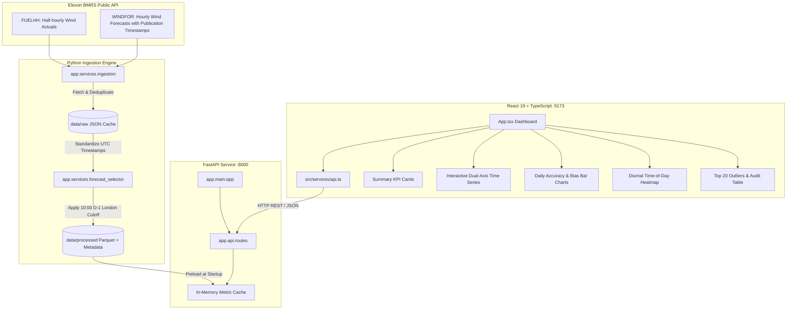

# Wind Forecast Intelligence Portal

> **Day-ahead wind forecast monitoring and accuracy analytics for UK electricity procurement.**

[](https://fastapi.tiangolo.com)
[](https://react.dev)
[](https://vitejs.dev)
[](https://pytest.org)
[](https://www.docker.com)
[-FF6F00.svg)](https://data.elexon.co.uk)

---

## Table of Contents

1. [Executive Summary & Business Context](#1-executive-summary--business-context)
2. [Key Analytics & January 2026 Findings](#2-key-analytics--january-2026-findings)
3. [Decision-Time Cutoff Methodology](#3-decision-time-cutoff-methodology)
4. [System Architecture](#4-system-architecture)
5. [User Interface Overview](#5-user-interface-overview)
6. [API Specification](#6-api-specification)
7. [Installation & Local Development](#7-installation--local-development)
8. [Docker & Containerized Deployment](#8-docker--containerized-deployment)
9. [Automated Testing & Validation](#9-automated-testing--validation)
10. [Cloud Deployment & Environment Variables](#10-cloud-deployment--environment-variables)
11. [Known Limitations & Roadmap](#11-known-limitations--roadmap)
12. [10-Minute Video Presentation Plan](#12-10-minute-video-presentation-plan)
13. [AI Disclosure](#13-ai-disclosure)

---

## 1. Executive Summary & Business Context

In Great Britain's wholesale electricity market, day-ahead power procurement desks must establish physical generation expectations prior to delivery day. With wind energy supplying a major, fluctuating share of the UK grid (frequently exceeding 15–20 GW during winter delivery months), procurement teams face significant physical volume variability:

* **Physical Volume Discrepancy**: Differences between the generation forecasted at decision cutoff time and the actual metered generation delivered represent volume mismatches that procurement teams must track and understand.
* **Directional Asymmetry**: Over-forecasting wind generation implies actual delivery fell short of the day-ahead forecast, whereas under-forecasting means actual delivered power exceeded expectations.
* **The Lookahead Trap**: System operators and forecasting providers publish frequent forecast revisions throughout the day. Evaluating forecast performance using revisions published *after* the procurement decision introduces lookahead leakage and hindsight bias.

The **Wind Forecast Intelligence Portal** solves this problem by strictly enforcing **decision-time eligibility**: for every delivery interval in January 2026, it isolates the **latest forecast published on or before the operational cutoff (provisional default: 10:00 Europe/London on D-1)**, pairs it with actual generation delivered, and computes rigorous accuracy analytics.

---

## 2. Key Analytics & January 2026 Findings

Evaluating all **1,488 half-hour settlement periods** across January 1–31, 2026 against the day-ahead 10:00 London cutoff reveals key analytical findings:

| Metric | Measured Value | Operational & Analytical Meaning |
|:---|:---:|:---|
| **Coverage** | **100.0%** (1,488 / 1,488) | Complete continuous data coverage; all 1,488 expected half-hourly settlement intervals have matched actuals and eligible forecasts in the January 2026 dataset. |
| **MAE** (Mean Absolute Error) | **2,126.1 MW** | Mean absolute difference between the decision-time forecast and delivered generation across all valid matched intervals. |
| **RMSE** (Root Mean Square Error) | **2,620.8 MW** | Penalizes larger individual errors; RMSE/MAE ratio of 1.23x highlights variance driven by large ramp discrepancies. |
| **Bias** (Mean Error: Forecast − Actual) | **+1,840.3 MW** | **Persistent Positive Over-forecasting**. Day-ahead forecasts averaged ~1.84 GW above actual generation across January. |
| **WAPE** (Weighted Absolute % Error) | **18.36%** | Normalized percentage error against total actual energy volume delivered (~17.2 TWh total generation). |

### Key Analytical Takeaways
1. **Systematic Over-Forecasting Bias**: A +1,840 MW mean bias indicates that the day-ahead BMRS WINDFOR forecasts available at 10:00 D-1 consistently overestimated national wind generation across January 2026.
2. **Diurnal Error Patterns**: Time-of-day analytics show that the highest absolute forecast deviations occur during afternoon delivery intervals (16:00–19:00 UTC).
3. **Largest Error Events**: The top 20 error intervals show individual half-hour discrepancies exceeding **6,500 MW** (maximum observed: ~6,857 MW). These events represent rapid generation ramps in the time series; note that external meteorological attribution is excluded since external weather datasets are outside the project scope.

---

## 3. Decision-Time Cutoff Methodology

### The Operational Cutoff Rule
To reflect realistic procurement deadlines, the portal enforces:
$$\text{Cutoff} = \text{10:00:00 Europe/London on Day } (D - 1)$$

For delivery on date $D$:
* **London Timezone Awareness**: Configured with `zoneinfo.ZoneInfo("Europe/London")`, automatically accounting for Greenwich Mean Time (GMT, UTC+0) in winter and British Summer Time (BST, UTC+1) in summer.
* **Eligible Forecast Set**:
  $$\mathcal{F}_{\text{eligible}}(t) = \{ f \in \text{WINDFOR} \mid f.\text{target\_time} = t \;\land\; f.\text{publish\_time} \le \text{Cutoff}(D) \}$$
* **Deterministic Selection**:
  $$\text{Selected Forecast}(t) = \operatorname{argmax}_{f \in \mathcal{F}_{\text{eligible}}(t)} (f.\text{publish\_time})$$
* **Hindsight Protection**: Forecast updates published at 10:01 on D-1 or during delivery day $D$ are discarded, regardless of how much more accurate they were.

### Temporal Resolution Alignment
* **Actuals (`FUELHH`)**: Published per 30-minute UK settlement period (48 intervals/day, fuelType `WIND`).
* **Forecasts (`WINDFOR`)**: Published per 60-minute resolution (24 hourly records/day).
* **Alignment Logic**: Each half-hour interval $[H:00, H:30)$ and $[H:30, H+1:00)$ maps to the forecast hour starting at $H:00$ ($\text{forecast\_hour} = \lfloor\text{actual\_startTime}\rfloor_{\text{hour}}$). This ensures every 30-minute settlement period has an explicit, auditable benchmark while transparently recording the 60-minute resolution property in the portal metadata.

---

## 4. System Architecture



---

## 5. User Interface Overview

The frontend is a dark-mode command center designed for energy traders and risk managers:

1. **Header & Context Banner**: Displays the operational cutoff policy (10:00 Europe/London, D-1), live backend connection status, and temporal alignment notice.
2. **KPI Scorecard**: Live cards displaying MAE, RMSE, Mean Bias (+1,840 MW with over-forecast tag), WAPE (18.36%), and Data Coverage (100%).
3. **Dual-Axis Time Series Chart**:
   * Interactive Recharts area/line visualization with Actual Wind Generation (MW), Day-Ahead Forecast (MW), and Net Forecast Error (MW).
   * Range presets: **Full Month (31d)**, **Week 1–4**, or custom date picker.
4. **Accuracy Breakdown**:
   * **Daily Accuracy**: Daily MAE and Bias bars showing wind storm volatility across January.
   * **Diurnal Error Profile**: Hourly 00:00–23:00 error breakdown showing procurement vulnerability during peak ramping periods.
5. **Error Distribution**: Binned histogram showing the frequency distribution of errors.
6. **Top 20 Discrepancies**: High-impact delivery intervals with generation, forecast, error delta, and exact forecast publication timestamps.
7. **Settlement Interval Audit Table**: Paginated, sortable table (50 rows/page) with full CSV export for regulatory auditing.

---

## 6. API Specification

| Method | Endpoint | Description | Query Parameters |
|:---|:---|:---|:---|
| `GET` | `/api/health` | Health check endpoint | None |
| `GET` | `/api/metadata` | Metadata, coverage, cutoff policy, source notes | None |
| `GET` | `/api/summary` | Global summary metrics (MAE, RMSE, Bias, WAPE) | None |
| `GET` | `/api/timeseries` | Full or date-filtered time series data | `date_from`, `date_to` |
| `GET` | `/api/accuracy/daily` | Day-by-day MAE, RMSE, and Bias breakdown | None |
| `GET` | `/api/accuracy/time-of-day` | 24-hour diurnal error and bias profile | None |
| `GET` | `/api/errors/top` | Top $N$ forecast discrepancy intervals | `n` (default 20, max 100) |
| `GET` | `/api/errors/distribution` | Histogram bins of forecast error distribution | `bins` (default 20) |
| `GET` | `/api/intervals` | Paginated settlement intervals with sorting | `page`, `page_size`, `status`, `sort_by`, `sort_order` |

All responses return standard ISO-8601 UTC timestamps (`YYYY-MM-DDTHH:MM:SSZ`) and numerical values in Megawatts (MW).

---

## 7. Installation & Local Development

### Prerequisites
* **Python 3.11+**
* **Node.js 20+** and `npm`
* Modern web browser (Chrome, Edge, Firefox, Safari)

### 1. Repository Setup
```bash
git clone https://github.com/narendar009/gridbricks-wind-portal.git
cd gridbricks-wind-portal
cp .env.example .env
```

### 2. Backend Setup
```bash
cd backend
python -m venv venv
# Windows:
.\venv\Scripts\activate
# Linux/macOS:
source venv/bin/activate

pip install -r requirements.txt
```

### 3. Data Ingestion (Optional — pre-ingested Parquet files included)
The repository includes pre-processed Parquet data for January 2026. To trigger a fresh ingestion directly from Elexon BMRS:
```bash
python -m app.services.ingestion --force
```

### 4. Run the Backend API Server
```bash
python -m uvicorn app.main:app --host 0.0.0.0 --port 8000 --reload
```
API docs available at: `http://localhost:8000/docs`

### 5. Frontend Setup & Launch
In a new terminal:
```bash
cd frontend
npm install
npm run dev
```
Open your browser at: `http://localhost:5173`

---

## 8. Docker & Containerized Deployment

Run the complete multi-service stack with reproducible Docker configurations:

### Prerequisites
* Docker Engine / Docker Desktop 24+
* Docker Compose v2+

### Commands Workflow
```bash
# 1. Validate docker compose configuration
docker compose config

# 2. Build backend and frontend images
docker compose build

# 3. Start services in the background
docker compose up -d

# 4. Verify running services and health status
docker compose ps

# 5. Inspect container logs
docker compose logs -f

# 6. Stop all containers cleanly
docker compose down
```

### Service Architecture & Networking
* **`gridbricks-backend`**: FastAPI application exposed on `http://localhost:8000` (`0.0.0.0:8000`).
  * Built from `backend/Dockerfile` with `python:3.11-slim`.
  * Pre-installs `pyarrow>=14.0.0` and all analysis dependencies.
  * Health check runs every 30s against `http://localhost:8000/api/health`.
* **`gridbricks-frontend`**: Production Vite React bundle served via Nginx Alpine on `http://localhost:5173` (`0.0.0.0:80`).
  * Built using multi-stage `frontend/Dockerfile`.
  * Configured via `VITE_API_BASE_URL=http://localhost:8000` at build time so browser requests reach the backend.
  * Waits for `gridbricks-backend` to become healthy before starting.
* **Persistent Storage**: `./data` is mounted to `/data` in the container to persist raw cache and processed Parquet files across restarts.
* **Context Cleanliness**: `.dockerignore` files in root, backend, and frontend prevent copying virtualenvs, `.git`, `node_modules`, or local secrets into container images.

### One-Shot Ingestion Inside Docker
```bash
docker compose run --rm ingest
```

---

## 9. Automated Testing & Validation

The test suite validates the decision-time selector, complete expected timeline generation, timezone arithmetic, metric computations, strict ISO date parsing, and lookahead protection:

```bash
# Run complete test suite in backend directory
cd backend
python -m pytest -v
```

### Test Coverage Highlights (92 Passed)
* **Timezone & Cutoff Logic**: Validates 10:00 Europe/London cutoff in both GMT (winter, UTC+0) and BST (summer, UTC+1) regimes.
* **Lookahead Protection**: Asserts that forecasts published after the cutoff (e.g. 10:00:01 on D-1) are strictly rejected even if newer or closer to delivery.
* **Complete Expected Timeline & Missing Actuals**: Generates the complete 1,488 half-hourly delivery timeline for January 2026 and left-joins actuals against it. If actual intervals are omitted, they are explicitly retained with `status='missing_actual'`, while forecasts are independently selected.
* **Tie-Breaking Determinism**: Confirms deterministic sorting by `(publish_time DESC, forecast_mw ASC)` when multiple forecasts share the same publish timestamp.
* **Mathematical Integrity**: Verifies MAE, RMSE, Mean Bias (+1,840.3 MW), and WAPE formulas against hand-calculated ground truth vectors. Validates zero denominators and empty datasets.
* **Strict API Date Validation**: Enforces ISO `YYYY-MM-DD` date parsing on `/api/timeseries` and `/api/intervals`. Verifies HTTP 400 for malformed dates, impossible dates (e.g., `2026-02-30`), and reversed date ranges (`date_from > date_to`).
* **Parquet Loading & PyArrow**: Verifies that PyArrow is installed and reads bundled datasets cleanly.

```text
============================== test session starts ==============================
collected 92 items

tests/test_api.py::TestHealthEndpoint::test_health_returns_ok PASSED
tests/test_api.py::TestTimeseriesEndpoint::test_timeseries_malformed_date_returns_400 PASSED
tests/test_api.py::TestTimeseriesEndpoint::test_timeseries_impossible_date_returns_400 PASSED
tests/test_api.py::TestTimeseriesEndpoint::test_timeseries_reversed_date_range_returns_400 PASSED
tests/test_api.py::TestIntervalsEndpoint::test_intervals_status_filter_missing_actual PASSED
tests/test_api.py::TestIntervalsEndpoint::test_intervals_reversed_date_range_returns_400 PASSED
tests/test_forecast_selector.py::TestExpectedTimelineAndMissingActuals::test_timeline_generation_includes_missing_actuals PASSED
tests/test_forecast_selector.py::TestExpectedTimelineAndMissingActuals::test_missing_actuals_excluded_from_metrics_and_counted_in_summary PASSED
... (92 tests total across test_forecast_selector.py, test_api.py, test_ingestion.py)
======================== 92 passed, 1 warning in 5.73s ========================
```

---

## 10. Cloud Deployment & Environment Variables

### Production URLs
* **Production Frontend (Vercel)**: [https://gridbricks-wind-portal.vercel.app/](https://gridbricks-wind-portal.vercel.app/)
* **Production Backend (Render)**: [https://gridbricks-wind-portal.onrender.com/](https://gridbricks-wind-portal.onrender.com/)

### Required Environment Variables

#### Backend (Render / Container Host)
| Variable | Default Value | Description |
|:---|:---|:---|
| `DATA_DIR` | `./data` (or `/data` in container) | Path to directory containing `raw/` and `processed/` data |
| `CORS_ORIGINS` | `https://gridbricks-wind-portal.vercel.app,http://localhost:5173,http://localhost:3000` | Comma-separated list of allowed origins (no wildcard in production) |
| `ANALYSIS_START_DATE` | `2026-01-01` | Start of delivery analysis scope (YYYY-MM-DD) |
| `ANALYSIS_END_DATE` | `2026-01-31` | End of delivery analysis scope (YYYY-MM-DD) |
| `CUTOFF_HOUR` | `10` | Hour of day-ahead decision cutoff (0–23) |
| `CUTOFF_MINUTE` | `0` | Minute of day-ahead decision cutoff (0–59) |
| `CUTOFF_TIMEZONE` | `Europe/London` | Local timezone for cutoff rule calculation |
| `CUTOFF_DAY_OFFSET` | `1` | Days prior to delivery date (1 = D-1) |
| `DEMO_MODE` | `false` | When `true`, serves synthetic fixtures if files are missing |
| `CACHE_TTL_SECONDS` | `300` | In-memory cache expiry in seconds |

#### Frontend (Vercel)
| Variable | Value | Description |
|:---|:---|:---|
| `VITE_API_BASE_URL` | `https://gridbricks-wind-portal.onrender.com` | Base URL pointing to deployed Render backend |

### Deployment Instructions
1. **Frontend on Vercel**:
   * Root Directory: `frontend`
   * Build Command: `npm run build`
   * Output Directory: `dist`
   * Set `VITE_API_BASE_URL=https://gridbricks-wind-portal.onrender.com`
   * SPA rewrites are pre-configured in `frontend/vercel.json`.
2. **Backend on Render**:
   * Environment: `Python 3` or `Docker`
   * Root / Context: `backend` (or project root with `requirements.txt`)
   * Build Command: `pip install -r requirements.txt`
   * Start Command: `uvicorn app.main:app --host 0.0.0.0 --port 8000`
   * Ensure `pyarrow>=14.0.0` is installed via `requirements.txt`.

---

## 11. Known Limitations & Roadmap

* **Single National Synchronous Zone**: BMRS WINDFOR and FUELHH data provide Great Britain-wide aggregates. In real operations, regional transmission constraints (such as the B6 Scottish boundary) cause localized wind curtailment that national figures do not isolate.
* **Provisional Cutoff Policy**: The 10:00 Europe/London D-1 cutoff is an operational application assumption reflecting typical utility day-ahead scheduling workflows, rather than a single statutory market rule. The backend fully supports configuring different hours and day offsets.
* **Single Weather Provider Model**: The dataset relies entirely on Elexon's published forecasts. Future enhancements could ingest multi-model numerical weather prediction (NWP) ensembles (ECMWF, GFS, Met Office) to construct probabilistic confidence bands.


---

## 12. AI Disclosure

In accordance with transparent engineering practices and hiring guidelines:
* **AI Tooling Used**: Antigravity AI Engineering Assistant (powered by Google DeepMind / Gemini and Anthropic Claude models) and OpenAI ChatGPT were utilized as pair programming and developer tooling assistants for scaffolding boilerplate, exploratory review, and drafting initial documentation outlines.
* **Engineering Ownership**: All final architectural choices, decision-cutoff algorithms, timezone normalization logic, metric formulations, schema definitions, data-quality pipelines, and bug fixes were verified, debugged, and validated by the submitting engineer.
* **Independent Verification**: All 92 automated tests, frontend builds, API routes, and container configurations have been executed and verified in the local development environment.
